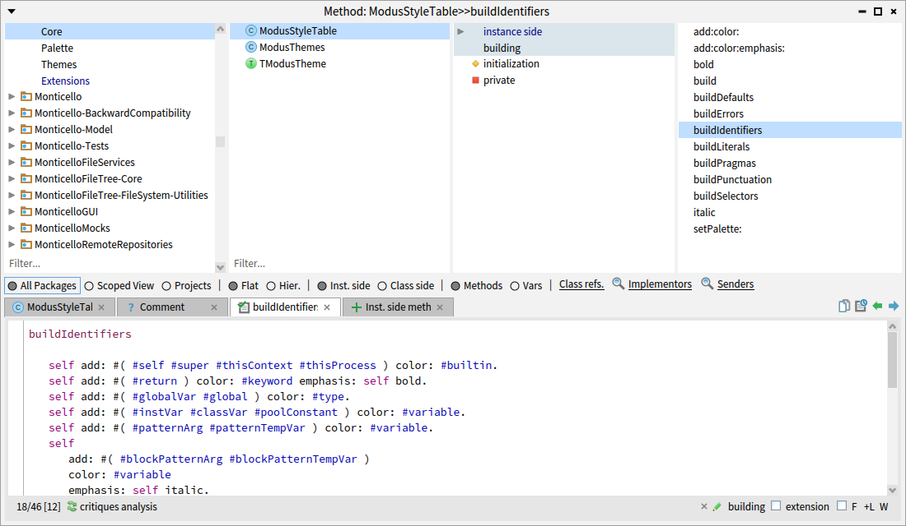
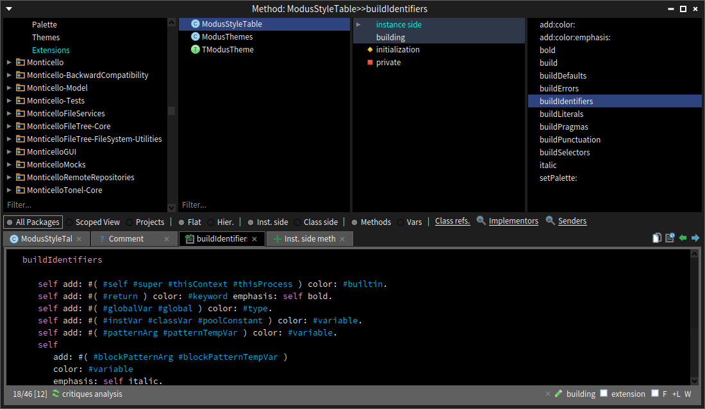
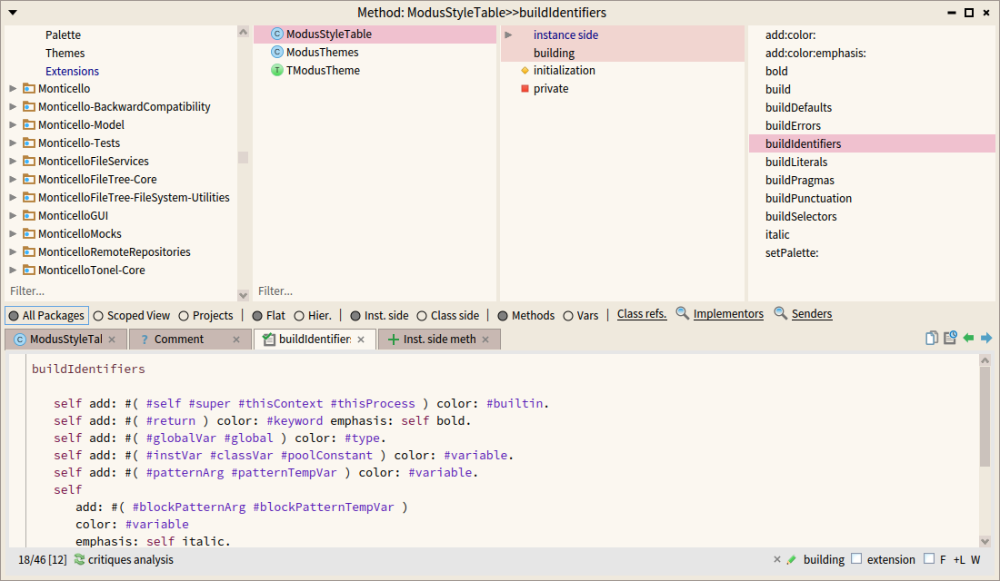
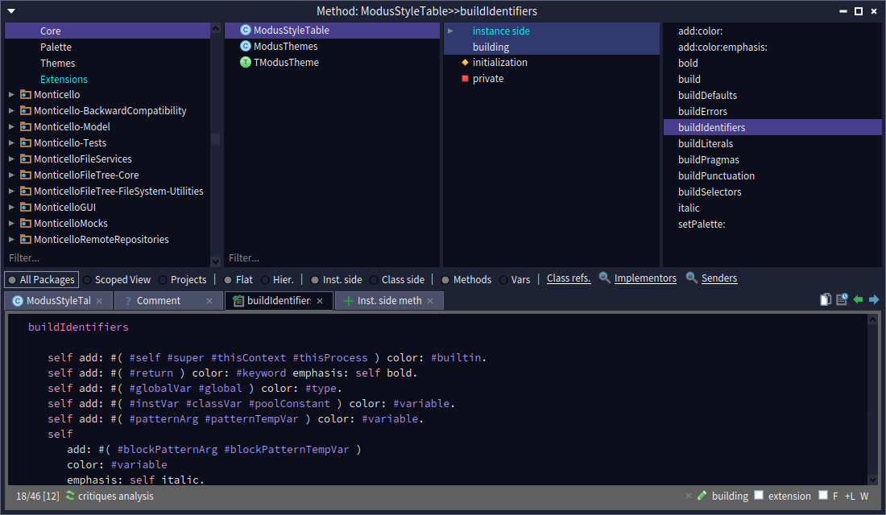
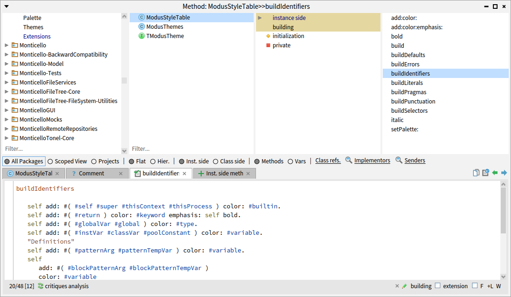
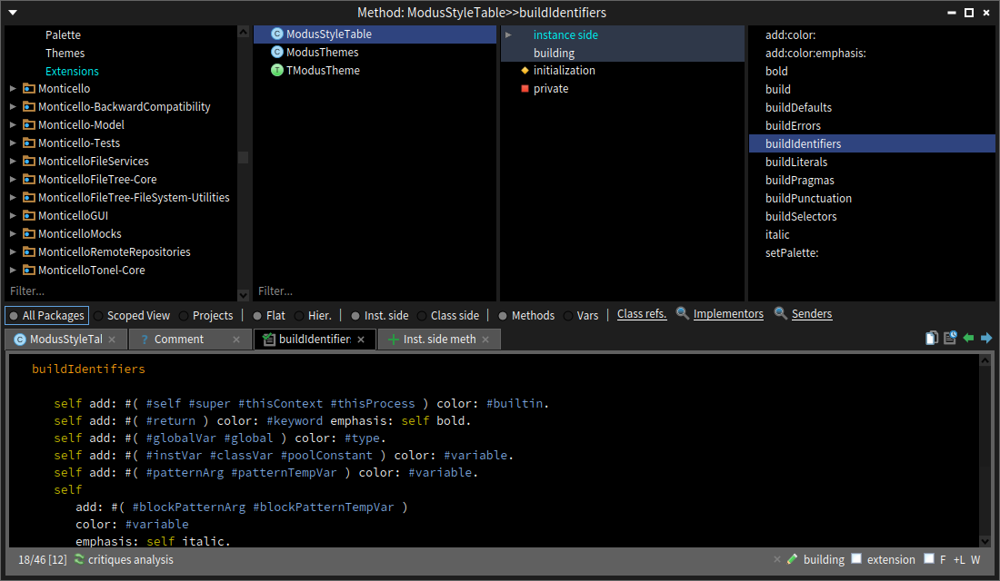
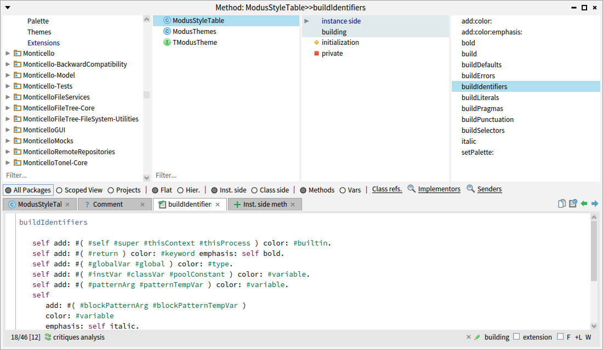
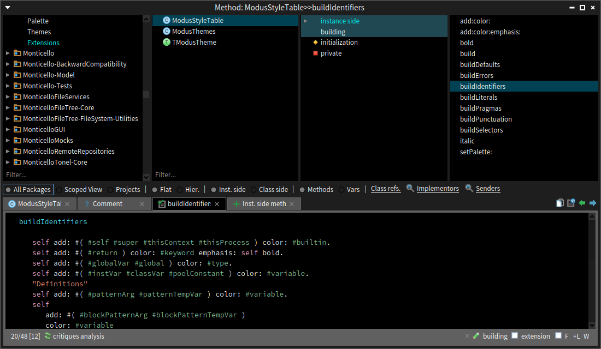

# Modus themes for Pharo

The [Modus themes](https://protesilaos.com/emacs/modus-themes) by Protesilaos Stavrou, ported from Emacs to [Pharo](https://pharo.org). Text has a contrast ratio of at least 7:1 against its background (WCAG AAA).




There are eight variants. Light ones are based on `PharoLightTheme`, dark ones on `PharoDarkTheme`.

| Light | Dark |
| --- | --- |
| `ModusOperandiTheme` | `ModusVivendiTheme` |
| `ModusOperandiTintedTheme` | `ModusVivendiTintedTheme` |
| `ModusOperandiDeuteranopiaTheme` | `ModusVivendiDeuteranopiaTheme` |
| `ModusOperandiTritanopiaTheme` | `ModusVivendiTritanopiaTheme` |

The deuteranopia variants are for red-green color blindness and use blue and yellow instead of red and green. The tritanopia variants are for blue-yellow color blindness and use red and cyan instead of blue and yellow.

<details>
<summary>Screenshots of the other variants</summary>








</details>

## Install

Pharo 9 or later. CI runs the tests on Pharo 9, 10, 11, 12 and 13.

```smalltalk
Metacello new
	baseline: 'ModusThemes';
	repository: 'github://balsa-sarenac/pharo-modus-themes:trunk/src';
	load.
```

Add `load: #('Tests')` to get the tests too.

### Load at startup

Pharo runs the `.st` files in its preferences folder every time an image starts. The folder is `~/.config/pharo/` on Linux, `~/Library/Preferences/pharo/` on macOS and `%APPDATA%\pharo\` on Windows. Put this in one of those files, for example `basicSettings.st`:

```smalltalk
StartupPreferencesLoader default executeAtomicItems: {
	StartupAction
		name: 'Modus themes'
		code: [
			[
			(Smalltalk globals includesKey: #ModusThemes) ifFalse: [
				Metacello new
					baseline: 'ModusThemes';
					repository: 'github://balsa-sarenac/pharo-modus-themes:trunk/src';
					onConflictUseLoaded;
					load ].
			(Smalltalk globals at: #ModusThemes) load: #vivendi ]
				on: Error
				do: [ :error | Transcript crShow: 'Modus themes: ' , error description ] ] }.
```

Each image downloads the themes the first time it starts and keeps them after that. Replace `#vivendi` with the variant you want. If there's no network, the image keeps its current theme and logs the error to the Transcript.

## Use

Pick a theme under *Settings > Appearance > User interface theme*, or:

```smalltalk
ModusThemes vivendi.
ModusThemes operandi.
ModusThemes load: #vivendiTinted.
ModusThemes toggle.    "between Operandi and Vivendi"
ModusThemes rotate.    "through all eight"
```

`toggle` switches between the pair in `ModusThemes toggleThemes`, which you can change:

```smalltalk
ModusThemes toggleThemes: #(#operandiTinted #vivendiTinted).
```

The syntax highlighting of each theme is also listed on its own in the *Syntax Highlighting* settings, so you can use it with a different UI theme.

### Bold and italics

Off by default, as in Emacs. Turn them on under *Settings > Appearance > Modus Themes*, or:

```smalltalk
ModusThemes boldConstructs: true.    "method names, ^, primitives"
ModusThemes italicConstructs: true.  "comments, block variables"
```

### Palette

Every color and semantic mapping from upstream is there, under its upstream name:

```smalltalk
(ModusPalette named: #vivendi) at: #'bg-main'.
(ModusPalette named: #operandiTinted) at: #string.
(ModusPalette named: #vivendi) colorNames.
UITheme current palette at: #'fg-dim'.    "when a Modus theme is current"
```

## Color mapping

| Pharo | Modus |
| --- | --- |
| Text, lists, editors | `bg-main`, `fg-main` |
| Windows, menus | `bg-dim` |
| Buttons | `bg-inactive`, `bg-hover` under the mouse |
| Selection | `bg-completion` |
| Unfocused selection | `bg-region` |
| Borders | `border` |
| Tooltips | `bg-active` |
| Taskbar, tabs | `bg-tab-bar`, `bg-tab-current`, `bg-tab-other` |
| Diffs | `bg-added`, `bg-removed`, `bg-changed` |
| Errors, warnings, success | `err`, `warning`, `info` |

| Code | Modus |
| --- | --- |
| Method name in its definition | `fnname` |
| `^` | `keyword` |
| `self`, `super`, `thisContext` | `builtin` |
| `true`, `false`, `nil`, symbols | `constant` |
| Strings, characters | `string` |
| Classes and other globals | `type` |
| Instance and class variables, declarations | `variable` |
| Arguments and temporaries where used | `variable-use` |
| Pragmas, primitives | `preprocessor` |
| Comments | `comment` |
| Numbers, messages, punctuation | `fg-main` |
| Nested `()`, `[]`, `{}` | `rainbow-1` to `rainbow-7` |
| Undeclared variables, syntax errors | `err` |

## Pharo versions

Pharo 11 moved theme colors into color configurator classes, which Pharo 9 and 10 don't have. Here the themes answer every color themselves (in the `TModusTheme` trait) and also write them into the theme settings that older versions read. The code is in Tonel v1, which Pharo 9 and later can load.

## Development

`ModusPaletteData` is generated from upstream:

```sh
git clone https://github.com/protesilaos/modus-themes /tmp/modus-themes
python3 scripts/generate-palettes.py /tmp/modus-themes/modus-themes.el
```

The screenshots are rendered by `scripts/screenshots.st` in the Screenshots workflow, which commits them to `images/screenshots/`.

## Credits

- [modus-themes](https://github.com/protesilaos/modus-themes) by Protesilaos Stavrou: palettes and semantic mappings.
- [modus-themes.nvim](https://github.com/miikanissi/modus-themes.nvim) by Miika Nissi: a port outside Emacs to compare against.
- [Pastels](https://github.com/Ducasse/Pastels) by Stéphane Ducasse: how a Pharo theme is put together.
