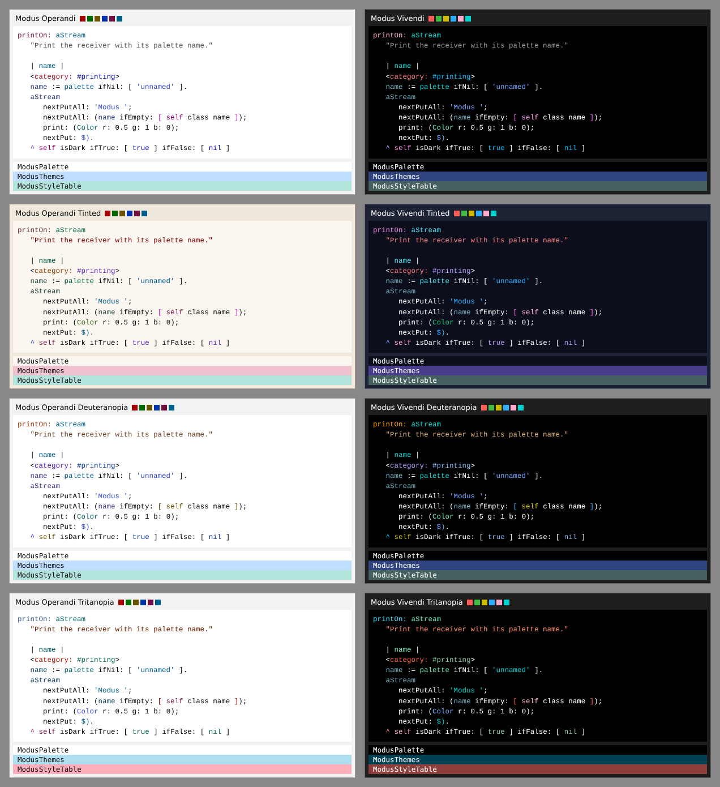

# Modus themes for Pharo

A port of the [Modus themes](https://protesilaos.com/emacs/modus-themes) by Protesilaos Stavrou to [Pharo](https://pharo.org). Modus themes are built for readability: main text reaches a contrast ratio of at least 7:1 against its background, which meets WCAG AAA.

All eight variants are included:

| Light (`PharoLightTheme`)          | Dark (`PharoDarkTheme`)           |
| ---------------------------------- | --------------------------------- |
| `ModusOperandiTheme`               | `ModusVivendiTheme`               |
| `ModusOperandiTintedTheme`         | `ModusVivendiTintedTheme`         |
| `ModusOperandiDeuteranopiaTheme`   | `ModusVivendiDeuteranopiaTheme`   |
| `ModusOperandiTritanopiaTheme`     | `ModusVivendiTritanopiaTheme`     |

The *deuteranopia* variants are for red-green color deficiency and use blue and yellow in place of red and green. The *tritanopia* variants are for blue-yellow color deficiency and use red and cyan in place of blue and yellow.



*Preview of the colors each variant uses for code, selection and hover, rendered from the palettes outside Pharo.*

Each theme covers the Morphic UI (windows, lists, text editors, buttons, menus, scrollbars, the taskbar, diffs, tooltips) and Shout syntax highlighting.

## Installation

Works in Pharo 9 and later. CI tests Pharo 9, 10, 11, 12 and 13.

```smalltalk
Metacello new
	baseline: 'ModusThemes';
	repository: 'github://balsa-sarenac/pharo-modus-themes:trunk/src';
	load.
```

To load the tests as well, add `load: #('Tests')`. To try a branch, put its name in place of `trunk`.

## Usage

Pick a theme in *Settings → Appearance → User interface theme*, or run:

```smalltalk
ModusThemes vivendi.                  "dark"
ModusThemes operandi.                 "light"
ModusThemes load: #vivendiTinted.     "any variant by name"
ModusVivendiDeuteranopiaTheme beCurrent.

ModusThemes toggle.                   "switch between Operandi and Vivendi, like modus-themes-toggle"
ModusThemes rotate.                   "cycle through all eight"
```

Each theme's syntax highlighting is also listed separately in the *Syntax Highlighting* settings, so you can combine it with another UI theme.

### Options

Like upstream, bold and italics are off by default. You can turn them on in *Settings → Appearance → Modus Themes*, or run:

```smalltalk
ModusThemes boldConstructs: true.     "method names, ^, primitives"
ModusThemes italicConstructs: true.   "comments, block arguments"
ModusThemes toggleThemes: #(#operandiTinted #vivendiTinted).
```

### Using the palette

All named colors and semantic mappings from upstream are available, under their upstream names:

```smalltalk
ModusPalette vivendi at: #'bg-main'.          "Color black"
ModusPalette operandiTinted at: #string.      "the color strings use"
ModusPalette vivendi colorNames.              "all 295 names"
UITheme current palette at: #'fg-dim'.        "when a Modus theme is current"
```

### Loading at startup in every image

Pharo runs the `.st` files in its preferences folder (`~/.config/pharo/` on Linux, `~/Library/Preferences/pharo/` on macOS, `%APPDATA%\pharo\` on Windows) when an image starts. Add this to one of them, such as `basicSettings.st`:

```smalltalk
StartupPreferencesLoader default executeAtomicItems: {
	StartupAction
		name: 'Modus themes'
		code: [
			[
			(Smalltalk globals includesKey: #ModusThemes) ifFalse: [
				Metacello new
					baseline: 'ModusThemes';
					repository: 'github://balsa-sarenac/pharo-modus-themes:trunk/src';
					onConflictUseLoaded;
					load ].
			(Smalltalk globals at: #ModusThemes) load: #vivendi ]
				on: Error
				do: [ :error | Transcript crShow: 'Modus themes: ' , error description ] ] }.
```

The themes are downloaded the first time an image starts and reused after that. Change `#vivendi` to the variant you want. If the image is offline, it keeps its current theme and notes the error in the Transcript.

## How it maps

The colors match the Emacs theme's semantic roles:

| Pharo                                   | Modus palette entry                |
| --------------------------------------- | ---------------------------------- |
| Text panes, lists, editors              | `bg-main` / `fg-main`              |
| Window and menu background              | `bg-dim`                           |
| Buttons                                 | `bg-inactive`, `bg-hover` on hover |
| Selection                               | `bg-completion`                    |
| Unfocused / secondary selection         | `bg-region` / `bg-hover-secondary` |
| Borders                                 | `border`                           |
| Tooltips                                | `bg-active`                        |
| Taskbar and tabs                        | `bg-tab-bar`, `bg-tab-current`, `bg-tab-other` |
| Diffs                                   | `bg-added`, `bg-removed`, `bg-changed` (and `-refine`) |
| Errors, warnings, success               | `err`, `warning`, `info`           |

Syntax highlighting:

| Smalltalk                               | Modus mapping                      |
| --------------------------------------- | ---------------------------------- |
| Method name in the definition           | `fnname`                           |
| `^`                                     | `keyword`                          |
| `self` `super` `thisContext`            | `builtin`                          |
| `true` `false` `nil`, symbols           | `constant`                         |
| Strings, characters                     | `string`                           |
| Class names and other globals           | `type`                             |
| Instance and class variables, declarations | `variable`                      |
| Uses of arguments and temporaries       | `variable-use`                     |
| Pragmas, primitives                     | `preprocessor`                     |
| Comments                                | `comment`                          |
| Numbers, message sends, punctuation     | `fg-main` (as upstream)            |
| Nested `()` `[]` `{}`                   | `rainbow-1` … `rainbow-7`          |
| Undefined variables, syntax errors      | `err`                              |

## Compatibility

Pharo 11 added *color configurators* (`UIThemeColorConfigurator`), which do not exist in Pharo 9 and 10. To work in all of these versions, the themes answer their colors directly through `TModusTheme`, a trait used by both `ModusOperandiTheme` and `ModusVivendiTheme`, and also write the colors into the theme settings that older versions read. The sources use Tonel v1, which every Pharo from 9 onwards can load.

## Updating the palettes

`ModusPalette`'s `*Entries` methods are generated from upstream `modus-themes.el`:

```sh
git clone https://github.com/protesilaos/modus-themes /tmp/modus-themes
python3 scripts/generate-palettes.py /tmp/modus-themes/modus-themes.el
```

## Credits

- [modus-themes](https://github.com/protesilaos/modus-themes) by Protesilaos Stavrou, for the palettes and their semantic mappings.
- [modus-themes.nvim](https://github.com/miikanissi/modus-themes.nvim) by Miika Nissi, for showing how a port outside Emacs can look.
- [Pastels](https://github.com/Ducasse/Pastels) by Stéphane Ducasse, for showing how a Pharo theme is put together.
